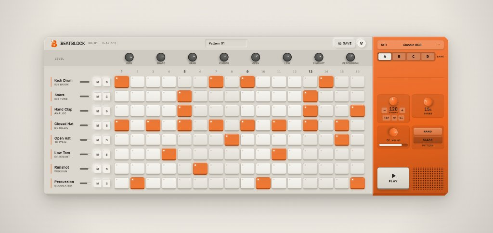

# BeatBlock

A tactile, neumorphic 8-channel × 16-step drum machine in the browser built with React, TypeScript, and the Web Audio API.



## Features

- **8 × 16 Step Sequencer** — Real-time Web Audio scheduling with tempo, swing, per-channel volume, mute/solo, and kit selection.
- **Hybrid Sound Engine** — Combines bundled high-fidelity drum samples with synthesized modular Web Audio voices across multiple sound kits (Lo-Fi Dust, Studio Acoustic, Classic 808, Jungle Breaks, Trap Hi-Fi, Electro Pop, Boom Bap, Acid Techno).
- **Multi-Theme Engine & Theme Picker** — 8 curated daylight and dark neumorphic visual themes: *Warm Ivory*, *Dark Obsidian*, *Dusk Rose*, *Ocean Deep*, *Forest Moss*, *Acid Violet*, *Midnight Indigo*, and *Ember Forge*.
- **Pattern Banks & Persistence** — Fast A/B/C/D variation banks, JSON export/import, and robust local autosave with session recovery.
- **Responsive Hardware Chassis** — Neumorphic hardware enclosure with full desktop board, mobile landscape compact mode, and portrait orientation prompt.
- **Landing Showcase** — Interactive product introduction hero with direct launch into the studio.

## Tech Stack

- **UI:** React 19, TypeScript, Vite 6, Lucide React
- **Audio:** Web Audio API
- **Testing:** Vitest, Testing Library, jsdom
- **Styling:** Modular CSS Tokens with neumorphic elevations and dynamic color palettes

## Getting Started

```bash
npm install
npm run dev
```

### Scripts

| Command | Description |
| --- | --- |
| `npm run dev` | Start the Vite development server |
| `npm run build` | Type-check with `tsc` and build for production |
| `npm test` | Run the Vitest test suite |
| `npm run preview` | Preview the production build locally |

## Documentation

Product, design, and engine specifications live in [`docs/`](./docs).
